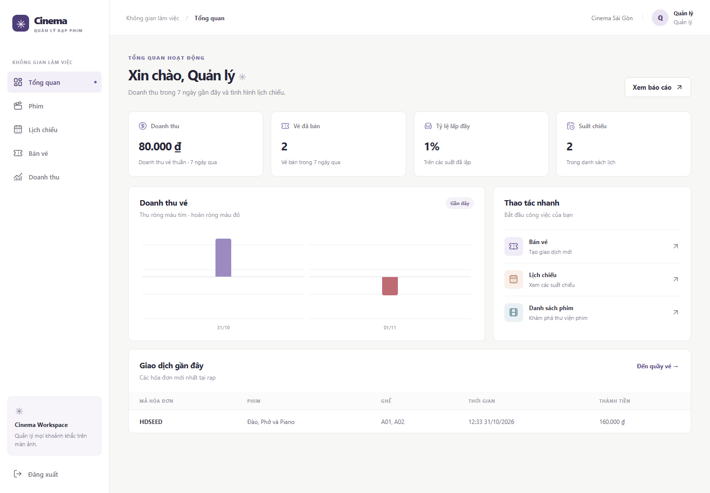

# Hệ thống quản lý rạp chiếu phim

Ứng dụng mô phỏng các công việc tại rạp chiếu phim: quản lý phim, xếp lịch chiếu, bán vé tại quầy và thống kê doanh thu. Dự án sử dụng React, TypeScript, Express và SQLite.



## Chức năng

- Tìm phim theo tên, mã hoặc năm; thêm và sửa thông tin phim.
- Tạo lịch chiếu, tính giờ kết thúc và kiểm tra trùng phòng, trùng giờ.
- Chọn ghế theo suất, tra cứu hoặc đăng ký thành viên, đổi điểm và bán kèm dịch vụ.
- Lập, tra cứu, in hóa đơn và trả vé theo thời gian còn lại trước giờ chiếu.
- Xem doanh thu theo phim hoặc rạp, sau đó xem chi tiết từng suất và hóa đơn.
- Phân quyền quản lý và nhân viên bán vé.

## Cài đặt

Yêu cầu Node.js từ phiên bản 24 và npm.

```bash
git clone https://github.com/Feanor1206/cinema-management-demo.git
cd cinema-management-demo
npm ci
npm run dev
```

Truy cập [http://127.0.0.1:3000](http://127.0.0.1:3000).

| Vai trò          | Tên đăng nhập | Mật khẩu     |
| ---------------- | ------------- | ------------ |
| Quản lý          | `manager`     | `Cinema123!` |
| Nhân viên bán vé | `cashier`     | `Cinema123!` |

Quản lý được thêm, sửa phim và lập lịch. Nhân viên bán vé được thao tác và xem báo cáo trong phạm vi rạp của mình.

## Dữ liệu mẫu

Lần chạy đầu tiên, ứng dụng tạo dữ liệu phim, phòng, suất chiếu, dịch vụ và một số giao dịch. Thành viên Nguyễn Văn B, số điện thoại `0987654321`, có sẵn 650 điểm để thử chức năng đổi vé.

Ở suất mẫu, chọn F05 Standard giá 80.000 đồng và F06 VIP giá 100.000 đồng. Đổi 500 điểm cho F05 rồi thanh toán F06: số tiền thu là 100.000 đồng, khách được cộng 10 điểm và còn 160 điểm.

Cơ sở dữ liệu được lưu tại `data/cinema.sqlite` và giữ lại khi khởi động lại. Để thử lại từ đầu, đặt `DATABASE_PATH` trỏ đến một tệp SQLite mới. Có thể thay đổi địa chỉ và cổng bằng các biến môi trường `HOST`, `PORT`.

## Build và kiểm thử

```bash
npm run build
npm start
```

Chạy các kiểm tra mã nguồn và nghiệp vụ:

```bash
npm run check
npx playwright install chromium
npm run test:e2e
```

Các kiểm thử bao gồm xung đột lịch, bán trùng ghế, đổi điểm, trả vé, phân quyền, báo cáo và lưu dữ liệu sau khi khởi động lại. Playwright kiểm tra các thao tác trên giao diện, gồm cả màn hình nhỏ.

## Cấu trúc thư mục

```text
web/        Giao diện React
server/     API, xử lý nghiệp vụ và truy vấn SQLite
shared/     Kiểu dữ liệu dùng chung
tests/      Kiểm thử API và giao diện
docs/       Tài liệu và kịch bản trình bày
```

Xem thêm [mô tả chức năng và API](docs/SPEC.md), [cấu trúc chương trình](docs/ARCHITECTURE.md) và [kịch bản trình bày](docs/DEMO.md).

## Phạm vi bản demo

Thanh toán và hoàn tiền được ghi nhận tại quầy, chưa tích hợp cổng thanh toán. Đổi điểm hỗ trợ mức 500 điểm cho một vé 2D Standard; chưa hỗ trợ quy đổi dịch vụ. Vé đổi điểm không được hoàn tiền hoặc hoàn điểm. Khi trả vé mua bằng tiền, hệ thống thu hồi điểm đã cộng; nếu số dư không đủ thì giao dịch trả bị từ chối.

Báo cáo chỉ tính tiền vé sau ưu đãi và các khoản hoàn trong kỳ, không bao gồm doanh thu dịch vụ.
