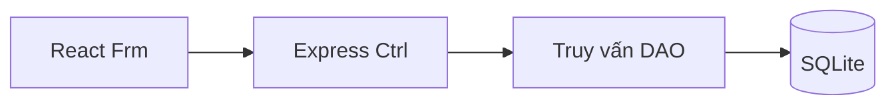

# Cấu trúc chương trình

`web/` chứa các màn hình và hàm gọi API dùng chung. `shared/contracts.ts` định nghĩa dữ liệu trao đổi; `server/app.ts` tổ chức route, kiểm tra quyền và xử lý nghiệp vụ; `server/db.ts` tạo bảng và dữ liệu mẫu.

Giao dịch bán và trả vé dùng transaction. Ràng buộc ghế theo suất trong CSDL chặn ghi trùng; dữ liệu giá, ưu đãi và điểm của vé được giữ tại thời điểm bán. Trả vé ghi khoản hoàn riêng, giúp báo cáo theo ngày bán và ngày hoàn chính xác. Truy vấn báo cáo dùng khoảng UTC tương ứng ngày Việt Nam và chỉ mục thời gian; xem chi tiết không truy vấn lặp theo từng hóa đơn.

Session dùng cookie HttpOnly, SameSite=Lax và token ngẫu nhiên lưu phía máy chủ. API kiểm tra vai trò và phạm vi rạp, xác thực dữ liệu bằng Zod, truy vấn có tham số và kiểm tra Origin khi ghi. Máy chủ mặc định chỉ lắng nghe localhost. Tài khoản và mật khẩu dùng thử được công khai trong README vì đây là bộ dữ liệu demo.

`minimatch` được khóa ở 11.0.4 qua npm overrides để tránh GHSA-g3hv-75wg-m249 trong dependency của công cụ lint. Các API matcher dùng bởi ESLint và TypeScript ESLint đã được kiểm tra qua lint toàn dự án. npm không chạy lifecycle script của dependency; Vite/esbuild dùng gói binary theo nền tảng có sẵn trong lockfile.

Tài liệu đối chiếu: [Node SQLite](https://nodejs.org/api/sqlite.html), [Express 5](https://expressjs.com/en/guide/migrating-5/), [React](https://react.dev/learn), [Vite](https://vite.dev/guide/), [minimatch advisory](https://github.com/advisories/GHSA-g3hv-75wg-m249).
